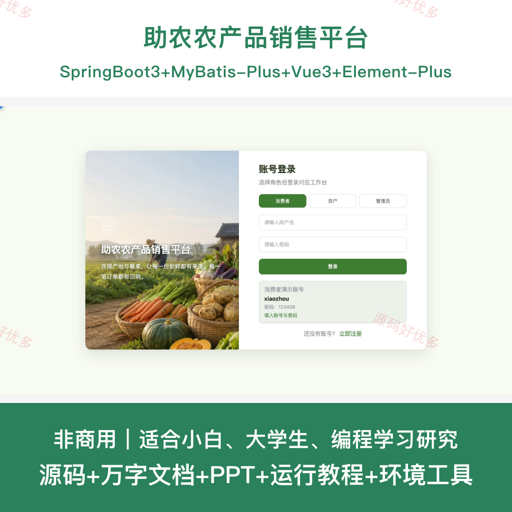
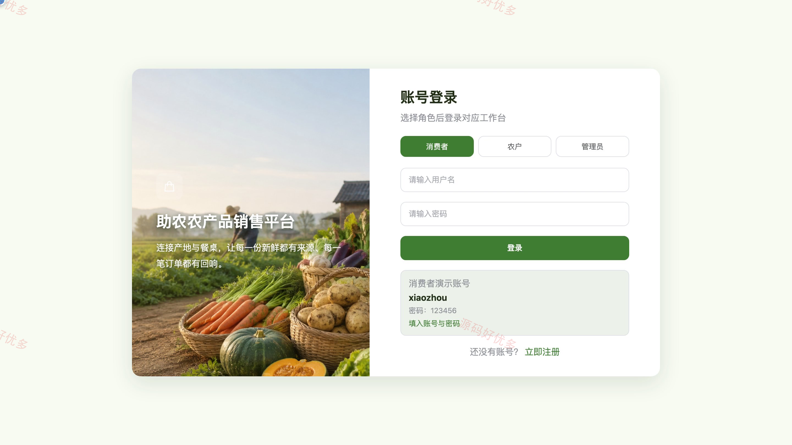
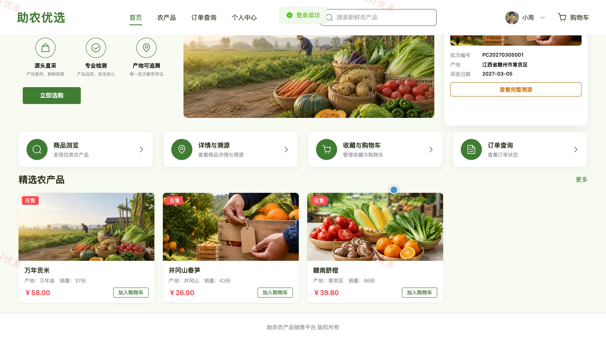
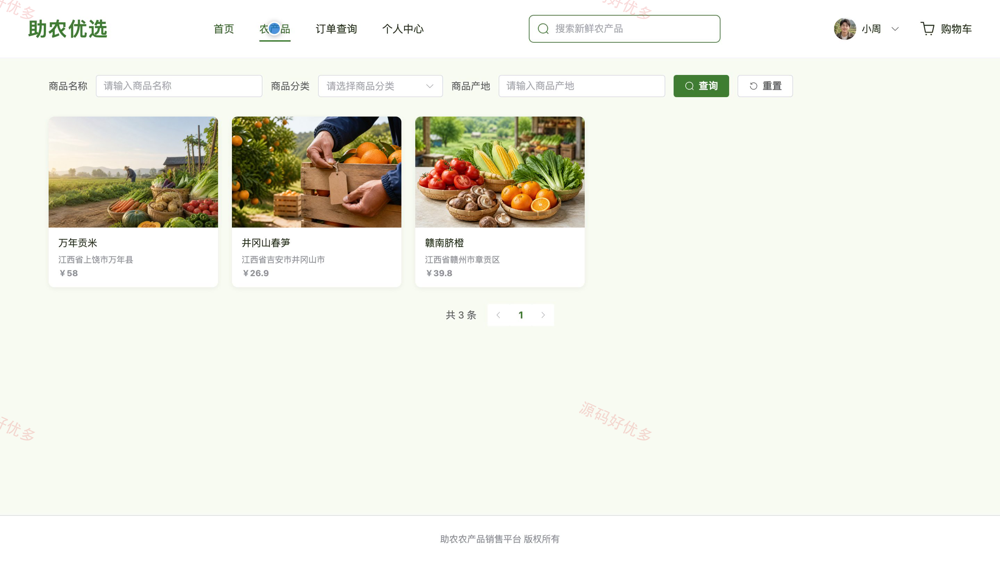
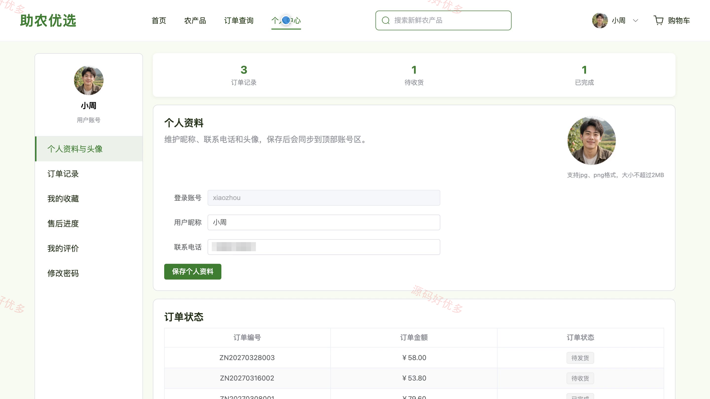
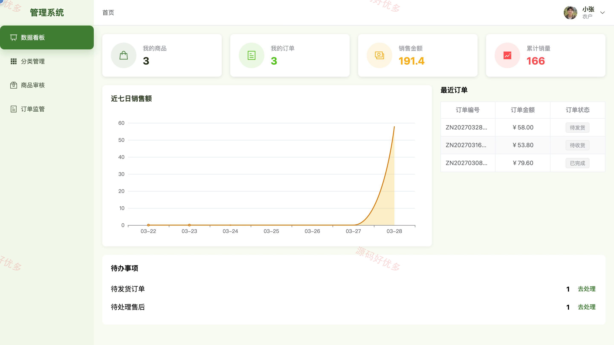
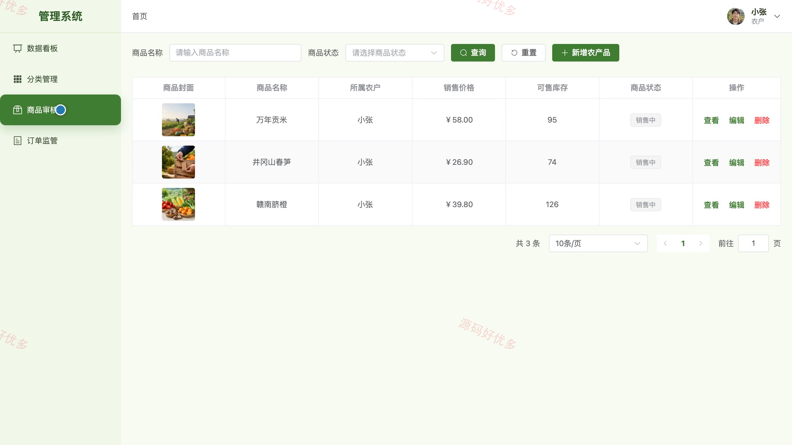
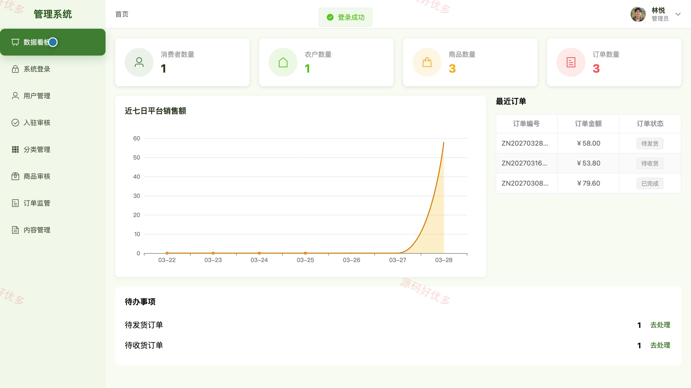
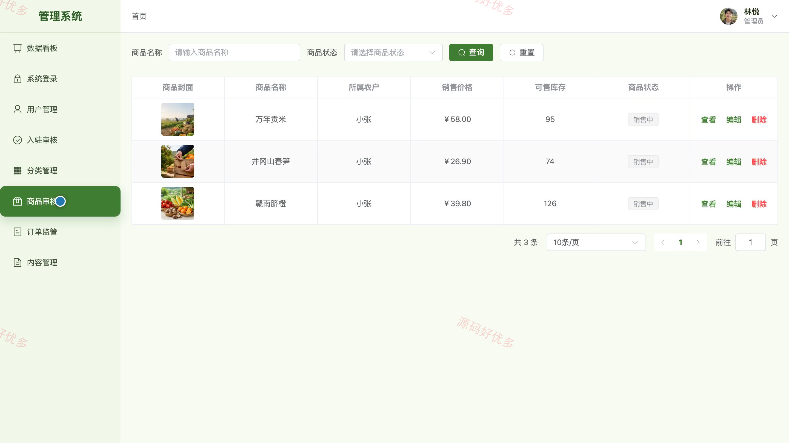

## 源码问题查看主页咨询

### 一、关键词
助农电商、农产品商城、农产品溯源、乡村电商、产地直销

### 二、作品包含
源码+数据库+万字设计文档+PPT+全套环境和工具资源+本地部署教程

### 三、项目技术
前端技术： Html、Css、Js、Vue3.4、Element-Plus
后端技术：Java、SpringBoot3.2.0、MyBatis-Plus

### 四、运行环境要求
开发工具：IDEA/eclipse + VSCODE

数据库：MySQL5.7+（共16张表）

数据库管理工具：Navicat10以上版本

环境配置软件： JDK17 + Maven3.6

前端Nodejs：16+

浏览器：谷歌浏览器

### 五、项目介绍
项目编号：bs119A

助农农产品销售平台连接消费者、农户与管理员，围绕农产品展示、批次溯源、在线下单、订单履约和平台监管形成完整业务闭环。消费者可选购并跟踪订单，农户可维护商品与溯源批次，管理员负责入驻审核、商品审核和运营管理。

角色：消费者、农户、管理员

消费者功能：注册登录、农产品筛选与详情查看、批次溯源查询、收藏与购物车管理、收货地址与订单提交、订单进度查询、确认收货与售后申请、商品评价与个人资料维护。

农户功能：注册登录与资质状态查看、入驻资质申请、农产品发布与编辑、批次溯源维护、库存定价与上下架、订单发货处理、售后处理与评价回复、销售数据统计。

管理员功能：后台登录与数据看板、消费者与农户管理、农户入驻审核、农产品分类管理、农产品审核与下架、订单与发货监管、轮播图和公告管理、平台经营数据统计。

### 六、运行截图

